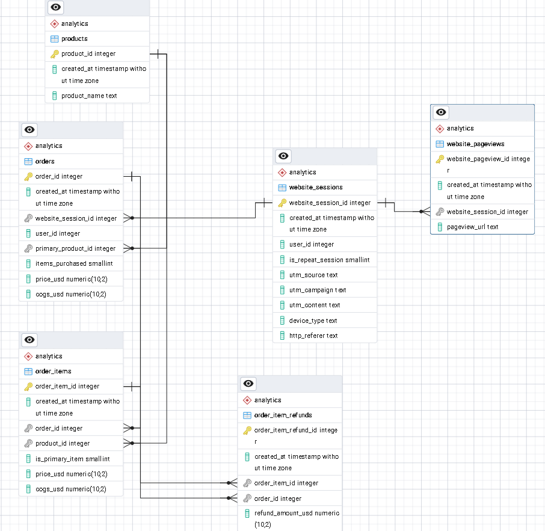

# Maven Fuzzy Factory: Analisis E-Commerce dengan PostgreSQL

Analisis 472.871 sesi web dan 32.313 order sebuah toko mainan online (Mar 2012 – Mar 2015) menggunakan PostgreSQL. Data dimodelkan dalam dua lapis (`raw` → `analytics`), logika bisnis dikemas dalam view, dan enam pertanyaan bisnis dijawab: pertumbuhan, channel, funnel, device, profitabilitas, dan pola waktu.

**Angka kunci**

- Konversi keseluruhan: 6,83%
- Pendapatan: ±1,94 juta USD
- Net margin: ±58,3% (hitungan dari tabel produk)



## Tiga temuan utama

1. **Konversi naik dua kali lipat di kedua device.** Konversi naik dari ±4,1% (2012) ke ±8,4% (Jan–Mar 2015) di desktop maupun mobile. Lonjakan terbesar terjadi sekali di langkah billing → thank you (50,1% → 62,7%, 2012 → 2013), dan itu lebih mirip perubahan situs daripada perubahan perilaku pembeli (hipotesis).
2. **bsearch setara gsearch hanya secara agregat.** Konversinya tampak sama (6,95% vs 6,87%) karena bsearch lebih desktop-heavy. Di dalam tiap device, gsearch lebih tinggi (desktop 8,47% vs 7,56%).
3. **Refund menjadi sumber kebocoran margin.** Refund Mr. Fuzzy melonjak ke 13,8% dan 13,3% pada Agu–Sep 2014 (tertinggi dalam 37 bulan, ±10 ribu USD atau ±1,5% net margin produk itu). Sugar Panda punya refund menetap tertinggi (6,0%).

## Pertanyaan bisnis dan jawaban singkat

| #   | Pertanyaan                                                                    | Jawaban singkat                                                                                 |
| --- | ----------------------------------------------------------------------------- | ----------------------------------------------------------------------------------------------- |
| Q1  | Bagaimana pertumbuhan bisnis dari waktu ke waktu?                             | Pendapatan bulanan tumbuh ±26× (Apr 2012 → Feb 2015), terutama dari sesi ×6,4 dan konversi ×3,3 |
| Q2  | Channel mana yang membawa traffic berkualitas?                                | socialbook berkonversi jauh lebih rendah; bsearch setara gsearch hanya secara agregat           |
| Q3  | Di langkah funnel mana pengunjung paling banyak hilang, dan apa yang berubah? | Cart paling lemah (45,2%) dan tidak membaik; perbaikan datang dari tiga langkah lain            |
| Q4  | Apakah desktop dan mobile berperilaku berbeda?                                | Desktop 8,50% vs mobile 3,09%; mobile tertinggal di setiap langkah                              |
| Q5  | Produk mana yang paling menguntungkan setelah retur?                          | Mr. Fuzzy terbesar tapi margin terendah (55,9%); Sugar Panda refund menetap tertinggi           |
| Q6  | Kapan traffic dan konversi paling tinggi?                                     | Volume bergantung jam dan hari; konversi hampir datar                                           |

## Dataset dan keterbatasan umum

- **Sumber:** Maven Analytics, _Toy Store E-Commerce Database_ (Maven Fuzzy Factory), enam tabel CSV, domain publik. Rentang data 19 Mar 2012 – 19 Mar 2015, 4 produk.
- **Kemungkinan data simulasi.** Pola yang rapi menunjukkan data dibuat untuk pembelajaran, sehingga kesimpulan tidak boleh digeneralisasi ke bisnis nyata.
- **Tidak ada data biaya iklan.** Yang bisa dinilai adalah kualitas traffic, bukan efisiensi atau ROI.
- **Bulan tidak penuh:** Maret 2012 dan Maret 2015.
- **Korelasi bukan sebab.** Peluncuran produk, perubahan halaman, dan perubahan channel terjadi dalam periode yang sama.

## Arsitektur data

```
CSV  →  schema raw (semua TEXT, salinan persis CSV)
     →  schema analytics (tabel bertipe, PK/FK)
     →  view: vw_sessions · vw_order_items_net · vw_session_funnel
```

Keputusan pembersihan dan definisi bisnis (aturan channel, asumsi net margin, penyederhanaan funnel) dicatat di [`docs/data_decisions.md`](docs/data_decisions.md).

## Analisis detail

Setiap angka di bawah dapat dilacak ke file SQL yang disebut di akhir tiap bagian.

### Q1. Bagaimana pertumbuhan bisnis dari waktu ke waktu?

Pendapatan bulanan tumbuh sekitar 26×, dari ±4,9 ribu USD (April 2012) menjadi ±129,2 ribu USD (Februari 2015). Pertumbuhan ini terurai menjadi tiga faktor:

| Faktor          | Perubahan               |
| --------------- | ----------------------- |
| Jumlah sesi     | ×6,4 (3.734 → 23.778)   |
| Conversion rate | ×3,3 (2,65% → 8,69%)    |
| Nilai per order | ×1,25 (±50 → ±62,5 USD) |

Karena 6,4 × 3,3 × 1,25 ≈ 26, pertumbuhan terutama datang dari lalu lintas yang naik, disusul perbaikan konversi. Kenaikan nilai order paling kecil kontribusinya. Angka konversi di atas membandingkan dua bulan; per tahun konversi naik sekitar 2× (±4,1% → ±8,4%, lihat Q3 dan Q4), yang lebih stabil.

Dari Maret 2013 ke Maret 2014, pendapatan bulanan naik ±48,3 ribu USD. Dua produk baru (Birthday Sugar Panda dan Hudson River Mini Bear) menyumbang ±36% kenaikan itu, sedangkan Mr. Fuzzy menyumbang ±48%, jadi produk baru tidak menggerus produk lama.

Pola musiman terlihat berulang: sesi naik di November–Desember lalu turun di Januari, dan Love Bear melonjak di Februari 2013, 2014, dan 2015. Pada Februari 2014 dan 2015, pendapatan Mr. Fuzzy turun sekitar 20% dibanding Januari saat Love Bear naik. Ini konsisten dengan pergeseran pilihan produk di momen hadiah. Karena Februari hanya 28 hari (sekitar 10% lebih pendek dari Januari), sebagian penurunan itu efek kalender, dan data tidak memastikan alasan pembeli berpindah.

Margin bersih turun di Agustus–September 2014 akibat lonjakan refund Mr. Fuzzy, bukan bauran produk (detail di Q5).

**Batasan:** Maret 2012 dan Maret 2015 bulan tidak penuh sehingga dikeluarkan dari pembacaan pertumbuhan. Kenaikan konversi bertepatan dengan peluncuran produk, tetapi sudah mulai naik sebelum produk kedua meluncur dan berbarengan dengan perubahan halaman landing, jadi efek produk tidak bisa dipisahkan.

_File: `sql/05_analysis_q1_q2.sql`_

### Q2. Channel mana yang membawa traffic berkualitas?

Pada periode yang sama, channel `socialbook` berkonversi jauh lebih rendah dibanding channel lain.

| Periode                                           | Channel    | Konversi                         | Channel lain |
| ------------------------------------------------- | ---------- | -------------------------------- | ------------ |
| Jan–Mar 2014 (pilot)                              | socialbook | 1,08% (55 order dari 5.095 sesi) | 6,9–10,1%    |
| Agu–Des 2014 (ditarget ke desktop, hanya desktop) | socialbook | 5,15%                            | 9,1–10,6%    |

Secara agregat bsearch (6,95%) dan gsearch (6,87%) tampak setara, tetapi bsearch jauh lebih desktop-heavy (86% vs 69% sesi). Setelah dipecah per device, gsearch lebih tinggi di desktop (8,47% vs 7,56%, selisih nyata) dan sedikit lebih tinggi di mobile (3,30% vs 3,11%, selisih kecil dan belum bisa dibedakan dari noise).

**Batasan:** Dataset tidak memuat biaya iklan, jadi yang dinilai adalah kualitas traffic, bukan efisiensi atau ROI. Konversi rendah belum berarti channel merugi jika biaya per klik sangat murah. Perbandingan hanya dilakukan pada periode yang sama karena tiap channel punya masa aktif berbeda.

_File: `sql/05_analysis_q1_q2.sql`, `sql/06_analysis_channel_margin.sql`, `sql/08_analysis_device.sql`_

### Q3. Di langkah mana pengunjung paling banyak hilang, dan apa yang berubah dari waktu ke waktu?

Dari 472.871 sesi, 32.313 (6,83%) sampai halaman thank-you, dan jumlah itu sama persis dengan jumlah order di tabel `orders`.

| Langkah                 | Laju lolos (seluruh periode) |
| ----------------------- | ---------------------------- |
| Landing → products      | 55,2%                        |
| Products → product page | 80,5%                        |
| Product page → cart     | **45,2%**                    |
| Cart → shipping         | 67,9%                        |
| Shipping → billing      | 80,7%                        |
| Billing → thank you     | 62,1%                        |

Berdasarkan volume, kehilangan terbesar ada di landing → products (211.640 sesi, 48% dari seluruh kehilangan), tetapi langkah pertama memang selalu paling bocor. Berdasarkan laju, product page → cart paling lemah dari enam langkah, dengan 115.261 sesi hilang di sana.

Kelemahan di cart ini bersifat tetap, bukan sumber perbaikan. Lajunya hampir tidak berubah (43,5% di 2012 → 45,1% di 2014), begitu juga cart → shipping dan shipping → billing. Konversi total naik dari ±4,1% (2012) ke ±7,2% (2014) dan ±8,4% (2015) terutama karena tiga langkah lain: billing → thank you (50,1% → 63,4%), products → product page (72,1% → 82,8%), dan landing → products (47,2% → 56,0%). Lonjakan billing → thank you terjadi sekali, antara 2012 dan 2013, lalu mendatar. Pola satu kali ini lebih mirip perubahan di situs daripada perubahan perilaku pembeli, tetapi itu masih hipotesis karena data pageview memuat beberapa versi halaman landing dan billing yang belum diuji.

**Implikasi:** cart adalah titik kebocoran besar yang belum membaik sejak 2012. Pengecekan yang masuk akal berikutnya adalah memecah laju cart per produk (harga 49,99 vs 59,99 USD) dan memeriksa kapan versi halaman berubah.

**Batasan:** funnel memakai flag "pernah mengunjungi" tanpa memeriksa urutan. 2012 hanya mencakup Mar–Des dan 2015 hanya Jan–Mar. Versi halaman landing dan billing digabung. Funnel ini tidak memuat harga atau ongkir, sehingga penyebab tidak bisa dibuktikan, dan perubahan antar tahun tidak membuktikan sebab-akibat.

_File: `sql/07_analysis_funnel.sql`_

### Q4. Apakah desktop dan mobile berperilaku berbeda?

|         | Porsi sesi | Konversi |
| ------- | ---------- | -------- |
| Desktop | 69,2%      | 8,50%    |
| Mobile  | 30,8%      | 3,09%    |

Konversi desktop sekitar 2,75× mobile. Mobile tertinggal di setiap langkah funnel, dengan selisih terbesar di products → product page (68,2% vs 84,9%) dan terkecil di product page → cart (42,1% vs 46,0%), sehingga kelemahan cart terjadi di kedua device. Karena defisit tersebar di seluruh funnel, sumbernya lebih mungkin pengalaman mobile secara umum daripada satu halaman rusak, tetapi ini hipotesis.

Konversi naik di kedua device sepanjang 2012–2015 (desktop 5,05% → 10,59%, mobile 1,47% → 3,50%), sehingga kenaikan konversi total tidak berasal dari perubahan bauran device. Sebaliknya, porsi mobile naik dari 25,4% ke 33,4% (2014) dan menahan konversi total. Lompatan terbesar terjadi di kedua device pada 2012 → 2013, lalu konversi mobile hampir mendatar sementara desktop terus naik, sehingga selisihnya melebar dari 3,6 menjadi 7,1 poin.

**Batasan:** data mengikat satu sesi ke satu device, jadi pembeli yang melihat di mobile lalu membeli di desktop tidak terlihat dan konversi mobile mungkin terlalu rendah. 2012 hanya Mar–Des dan 2015 hanya Jan–Mar, jadi unsur musiman bisa memengaruhi perbandingan. Data tidak menjelaskan kenapa mobile mendatar, dan tidak ada data biaya per device.

_File: `sql/08_analysis_device.sql`_

### Q5. Produk mana yang paling menguntungkan setelah memperhitungkan biaya dan retur?

| Produk      | Porsi pendapatan | Margin kotor | Refund | Net margin |
| ----------- | ---------------- | ------------ | ------ | ---------- |
| Mr. Fuzzy   | 62,5%            | 61,0%        | 5,1%   | 55,9%      |
| Love Bear   | 17,9%            | 62,5%        | 2,2%   | 60,3%      |
| Sugar Panda | 11,8%            | 68,5%        | 6,0%   | 62,5%      |
| Mini Bear   | 7,8%             | 68,4%        | 1,3%   | 67,1%      |

Mr. Fuzzy menyumbang 62,5% pendapatan dan 59,9% net margin, tetapi margin bersihnya terendah (55,9% vs 67,1% untuk Mini Bear). Sugar Panda punya refund rate tertinggi (6,0%) dan konsisten 4–7% per bulan, sedangkan Mr. Fuzzy pada periode yang sama hanya ±3,6%, sehingga ini terlihat sebagai masalah produk yang menetap.

Lonjakan refund Mr. Fuzzy pada Agu–Sep 2014 (13,8% dan 13,3%) adalah yang tertinggi dalam 37 bulan, lalu kembali ke 2,5% pada Oktober. Dampaknya diperkirakan ±10 ribu USD atau ±1,5% net margin produk itu. Secara umum refund rate Mr. Fuzzy turun dari ±6,9% (2012) ke ±3,5% (2015).

**Batasan:** refund dihitung di bulan order (bukan bulan refund diterbitkan). Net margin mengasumsikan harga penuh hilang dan COGS tidak kembali. Tidak ada kode alasan refund, jadi penyebab lonjakan tidak bisa dipastikan (kemungkinan masalah kualitas atau batch, perlu dicek ke tim operasional).

_File: `sql/09_analysis_profit.sql`_

### Q6. Pada jam dan hari apa traffic dan konversi paling tinggi?

Pada 2014, volume sesi sangat bergantung pada waktu: 51,7% sesi terjadi pada pukul 10.00–17.59 dan puncaknya (12.00, 15.724 sesi) sekitar 4× titik terendah (03.00, 3.811 sesi). Akhir pekan hanya memiliki sekitar 45% sesi hari kerja per hari.

Namun laju konversi hampir datar: 6,57–7,79% antar jam dan 6,88–7,36% antar hari, dibanding rata-rata 7,22%. Jumlah order karenanya mengikuti volume sesi, bukan peluang beli yang lebih tinggi pada waktu tertentu.

**Implikasi:** kapasitas layanan dan pemantauan wajar disesuaikan dengan jam 10.00–18.00 hari kerja, sedangkan penjadwalan iklan tidak bisa dinilai tanpa data biaya.

**Batasan:** hanya 2014, zona waktu tidak diketahui, tanpa uji signifikansi (variasi kecil seperti Rabu 6,88% bisa noise), dan tidak dipecah per device atau channel.

_File: `sql/10_analysis_time.sql`_

## Optimasi query

Pencarian pageview untuk satu sesi pada tabel ±1,19 juta baris:

|                | Sebelum indeks    | Sesudah indeks |
| -------------- | ----------------- | -------------- |
| Metode         | Parallel Seq Scan | Index Scan     |
| Waktu eksekusi | ±133 ms           | 0,05–0,08 ms   |
| Halaman dibaca | 9.237             | 4              |

```sql
CREATE INDEX idx_pageviews_session ON analytics.website_pageviews (website_session_id);
CREATE INDEX idx_orders_session    ON analytics.orders (website_session_id);
```

Hasil "sebelum" sama pada cache dingin dan hangat. Indeks tidak membantu agregasi seluruh tabel (seperti funnel keseluruhan) karena semua baris tetap dibaca, dan indeks menambah biaya penyimpanan dan penulisan, yang dapat diterima untuk data baca-saja ini.

_File: `sql/11_optimization.sql`_

## Teknik SQL yang dipakai

CTE · window function (`LAG`, `SUM() OVER`) · conditional aggregation (`FILTER`) · view bertingkat · profiling dan rekonsiliasi data · agregasi sebelum join untuk mencegah penggandaan baris · `EXPLAIN (ANALYZE, BUFFERS)` dan indeks B-tree.

## Struktur repo

```
fuzzy-factory/
├── sql/
│   ├── 01_schema.sql
│   ├── 02_profiling_raw.sql
│   ├── 03_load_analytics.sql
│   ├── 04_views.sql
│   ├── 05_analysis_q1_q2.sql
│   ├── 06_analysis_channel_margin.sql
│   ├── 07_analysis_funnel.sql
│   ├── 08_analysis_device.sql
│   ├── 09_analysis_profit.sql
│   ├── 10_analysis_time.sql
│   └── 11_optimization.sql
├── docs/
│   └── data_decisions.md
├── images/
└── data/            (tidak di-commit)
```

**[TODO]** Sesuaikan nama file di atas dengan nama file sebenarnya di repo.

## Cara menjalankan ulang

1. Pasang PostgreSQL dan buat database `fuzzy_factory`.
2. Jalankan `sql/01_schema.sql` (membuat schema `raw` dan `analytics`).
3. Impor keenam CSV ke tabel `raw` melalui pgAdmin (_Import/Export Data_, opsi **Header = ON**).
4. Jalankan `sql/02_profiling_raw.sql` (opsional), lalu `sql/03_load_analytics.sql` dan `sql/04_views.sql`.
5. Jalankan file analisis `sql/05` sampai `sql/11`.

**[TODO]** Uji langkah-langkah ini pada database kosong sebelum mempublikasikan README. Data CSV tidak disertakan di repo; unduh dari Maven Analytics.
